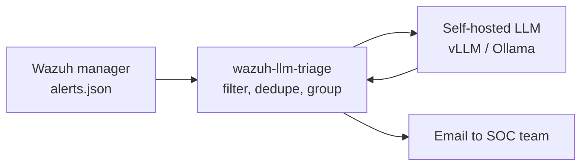

# wazuh-llm-triage

AI-assisted triage for Wazuh alerts using a **self-hosted LLM**.

The watcher follows Wazuh's `alerts.json`, groups related high-severity alerts into a single incident, asks a local LLM to analyse the incident, and emails the security team a report with a summary, a threat assessment, a severity rating, a MITRE ATT&CK mapping, investigation steps and recommended responses.

Alert data stays on your own infrastructure: the LLM runs on your own server (for example, vLLM or Ollama on a GPU VM), not a public AI service.



## Features

- **Incident grouping:** alerts with the same rule, source IP, host and level are grouped into one incident, so a 50-attempt brute force produces one email instead of 50.
- **Duplicate protection:** repeated copies of the same event are ignored.
- **Level filter:** only alerts at or above `MIN_LEVEL` (default 11) are processed.
- **Structured AI analysis:** the LLM must return JSON with severity, confidence, MITRE ATT&CK, investigation steps and recommended responses.
- **Advisory only:** the script never takes action itself. Analysts decide.
- **Prompt-injection guard:** log content is passed to the model as clearly marked untrusted data, and the model is told never to follow instructions inside it.
- **Log rotation safe:** keeps working after Wazuh rotates `alerts.json` each night.
- **Graceful fallback:** if the LLM is down or returns bad JSON, the email is still sent with the raw Wazuh events.
- **Works with any OpenAI-compatible endpoint:** vLLM, Ollama and others.

See [`examples/sample-email.txt`](examples/sample-email.txt) for an example report (fake data).

## Requirements

- Wazuh manager with JSON alerts enabled (`<jsonout_output>yes</jsonout_output>`, the default)
- Python 3.8+ and `requests`
- An OpenAI-compatible LLM endpoint. Tested with Llama 3.1 8B Instruct on vLLM.
- An SMTP account for sending email

## Installation

```bash
# On the Wazuh manager
sudo mkdir -p /opt/wazuh-llm-triage
sudo cp wazuh_llm_triage.py /opt/wazuh-llm-triage/
sudo pip3 install -r requirements.txt

# Service user that can read Wazuh alerts
sudo useradd --system --no-create-home --groups wazuh wazuh-triage

# Settings (keep this file private)
sudo cp .env.example /etc/wazuh-llm-triage.env
sudo chmod 600 /etc/wazuh-llm-triage.env
sudo nano /etc/wazuh-llm-triage.env

# Run as a service
sudo cp deploy/wazuh-llm-triage.service /etc/systemd/system/
sudo systemctl daemon-reload
sudo systemctl enable --now wazuh-llm-triage
```

Check that it is running:

```bash
systemctl status wazuh-llm-triage
tail -f /var/log/wazuh-llm-triage/wazuh-llm-triage.log
```

## Configuration

All settings are environment variables (see [`.env.example`](.env.example)).

| Variable | Default | Purpose |
|---|---|---|
| `ALERT_FILE` | `/var/ossec/logs/alerts/alerts.json` | Wazuh alert file to follow |
| `MIN_LEVEL` | `11` | Minimum Wazuh rule level to process |
| `AGGREGATION_WINDOW` | `30` | Seconds of quiet before an incident is sent |
| `MAX_EVENTS_PER_INCIDENT` | `100` | Events kept per incident |
| `LLM_URL` | `http://localhost:8000/v1/chat/completions` | OpenAI-compatible chat endpoint |
| `LLM_MODEL` | `meta-llama/Llama-3.1-8B-Instruct` | Model name as known to the server |
| `LLM_API_KEY` | *(empty)* | Optional bearer token for the LLM server |
| `LLM_TIMEOUT` | `120` | LLM request timeout in seconds |
| `GEOIP_ENABLED` | `true` | Look up source IP location via ipinfo.io |
| `SMTP_SERVER`, `SMTP_PORT` | `smtp.gmail.com`, `587` | Mail server (STARTTLS) |
| `EMAIL_USER`, `EMAIL_PASS` | | SMTP login |
| `EMAIL_TO` | | Comma-separated recipients |
| `LOG_FILE` | `/var/log/wazuh-llm-triage.log` | Watcher log |

## Security notes

- **Treat AI output as advice.** The LLM can be wrong. Always verify against the raw events, which are included in every email.
- **Attackers control parts of the logs.** Text in `full_log` may contain prompt-injection attempts. The prompt marks it as untrusted, but no prompt is perfect, so never connect this tool to automatic response actions.
- **GeoIP sends source IPs to ipinfo.io.** Set `GEOIP_ENABLED=false` if that is not acceptable in your environment.
- **Protect your secrets.** Keep `/etc/wazuh-llm-triage.env` at `chmod 600` and never commit it.
- **Put authentication on your LLM endpoint** and set `LLM_API_KEY`, especially if the model server is reachable from other hosts.

## Roadmap

- Slack / Microsoft Teams notifications
- Optional local GeoIP database instead of ipinfo.io
- Unit tests and CI

## License

MIT. See [LICENSE](LICENSE).
